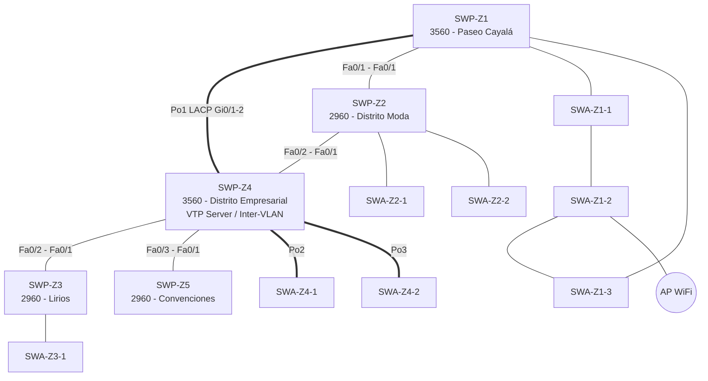
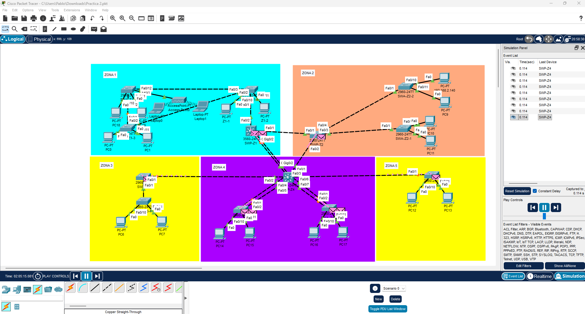
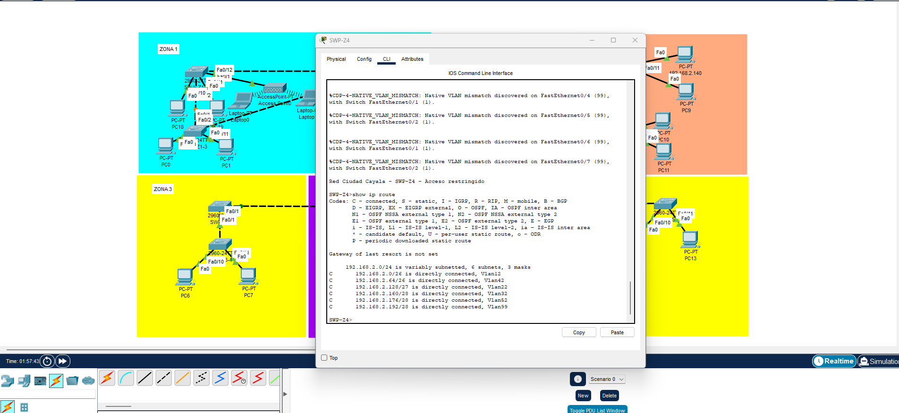

# Manual Técnico – Práctica 2: Red de la Ciudad Comercial Cayalá

**Curso:** Redes de Computadoras 1 – Segundo Semestre 2026
**Estudiante:** Pablo Isai Matusalen Cutzal Mazariegos
**Carnet:** 202209622

---

## 1. Datos que salen del carnet

| Dato | Valor |
|---|---|
| Último dígito del carnet (X) | 2 |
| VLANs de zona | 12, 22, 32, 42, 52 |
| Dominio VTP | 202209622 |
| Contraseña VTP | Cayala2026 |
| Protocolo EtherChannel | LACP (802.3ad), porque 2 es par |
| VLAN nativa | 99 |
| VLAN Blackhole | 999 |

---

## 2. Zonas seleccionadas de Cayalá

Para escoger las zonas revisé el sitio de Cayalá y fuentes públicas. Ciudad Cayalá es un desarrollo de uso mixto en zona 16 que tiene un centro comercial (Paseo Cayalá), un distrito de moda, residenciales, un distrito empresarial de oficinas, hoteles y un centro de convenciones. Escogí estas 5:

| Zona | Lugar real | VLAN | Hosts | Rol operativo | Usuarios | Tráfico estimado | Criticidad |
|---|---|---|---|---|---|---|---|
| Zona 1 | Paseo Cayalá (tiendas, restaurantes, cine) | 12 | 60 | Corazón comercial del complejo. Puntos de venta, cajas, kioscos, WiFi para clientes | Locatarios, cajeros, visitantes | Alto (ventas todo el día, fines de semana muy cargados) | Alta |
| Zona 2 | Distrito Moda | 22 | 28 | Boutiques y tiendas de ropa, POS y consultas de inventario | Personal de tiendas | Medio-alto | Media-alta |
| Zona 3 | Lirios de Cayalá (residencial, 28 condominios) | 32 | 12 | Garita, administración del condominio, control de acceso | Guardias, administrador | Bajo | Media-baja |
| Zona 4 | Distrito Empresarial – Administración central y monitoreo | 42 | 50 | Administración del complejo, centro de monitoreo de cámaras y seguridad, aquí está el switch que enruta entre VLANs | Personal administrativo, seguridad, TI | Alto (es el paso obligado entre zonas) | Alta (si cae, se cae todo) |
| Zona 5 | Centro de Convenciones Cayalá | 52 | 7 | Registro de eventos, taquilla, cabina de audio | Personal de eventos | Bajo e intermitente (solo en eventos) | Baja |

---

## 3. Topología

### 3.1 Topología entre zonas (backbone)

La topología es híbrida, combina **malla** y **estrella**:

- **Malla (triángulo)** entre SWP-Z1, SWP-Z2 y SWP-Z4. Son las zonas críticas o de más tráfico, cada una tiene 2 caminos hacia la red. Si se cae un enlace STP desbloquea el otro.
- **Estrella** desde SWP-Z4 hacia SWP-Z3 y SWP-Z5. Son zonas de poco tráfico y menor criticidad, entonces con un solo enlace es suficiente y no gasto puertos ni cable de más.

Además dentro de las zonas también cambia el esquema:

| Zona | Topología interna | Por qué |
|---|---|---|
| Zona 1 – Paseo Cayalá | Anillo (SWP-Z1 → SWA-Z1-1 → SWA-Z1-2 → SWA-Z1-3 → SWP-Z1) | Es la zona con más hosts. Con el anillo si se rompe un cable entre switches de acceso los demás siguen llegando por el otro lado |
| Zona 2 – Distrito Moda | Estrella | Tráfico medio, con 2 switches de acceso colgados del principal es suficiente |
| Zona 3 – Lirios | Estrella simple (1 switch de acceso) | Pocos hosts |
| Zona 4 – Distrito Empresarial | Estrella con enlaces dobles agrupados en EtherChannel (Po2 y Po3) | Es zona crítica y además concentra el tráfico entre VLANs |
| Zona 5 – Convenciones | Hosts directo al switch principal | Solo 7 hosts y uso ocasional |

### 3.2 Diagrama



Topología final armada en Packet Tracer:



### 3.3 Tabla de enlaces físicos

| Origen | Puerto | Destino | Puerto | Cable | Tipo | VLANs permitidas | Justificación |
|---|---|---|---|---|---|---|---|
| SWP-Z1 | Gi0/1 | SWP-Z4 | Gi0/1 | Cobre cruzado (Gigabit) | Trunk Po1 | 12,22,99 | Enlace principal de la zona con más hosts, va agrupado en EtherChannel |
| SWP-Z1 | Gi0/2 | SWP-Z4 | Gi0/2 | Cobre cruzado (Gigabit) | Trunk Po1 | 12,22,99 | Segundo enlace del EtherChannel |
| SWP-Z1 | Fa0/1 | SWP-Z2 | Fa0/1 | Cobre cruzado | Trunk | 12,22,99 | Camino alterno de Z1 y Z2 (malla) |
| SWP-Z2 | Fa0/2 | SWP-Z4 | Fa0/1 | Cobre cruzado | Trunk | 12,22,99 | Enlace principal de Z2 hacia el core |
| SWP-Z4 | Fa0/2 | SWP-Z3 | Fa0/1 | Cobre cruzado | Trunk | 32,99 | Estrella, zona de baja criticidad |
| SWP-Z4 | Fa0/3 | SWP-Z5 | Fa0/1 | Cobre cruzado | Trunk | 52,99 | Estrella, zona de baja criticidad |
| SWP-Z4 | Fa0/4-5 | SWA-Z4-1 | Fa0/1-2 | Cobre cruzado | Trunk Po2 | 42,99 | Doble enlace para la zona crítica |
| SWP-Z4 | Fa0/6-7 | SWA-Z4-2 | Fa0/1-2 | Cobre cruzado | Trunk Po3 | 42,99 | Doble enlace para la zona crítica |
| SWP-Z1 | Fa0/2 | SWA-Z1-1 | Fa0/1 | Cobre cruzado | Trunk | 12,99 | Anillo Z1 |
| SWA-Z1-1 | Fa0/2 | SWA-Z1-2 | Fa0/1 | Cobre cruzado | Trunk | 12,99 | Anillo Z1 |
| SWA-Z1-2 | Fa0/2 | SWA-Z1-3 | Fa0/1 | Cobre cruzado | Trunk | 12,99 | Anillo Z1 |
| SWA-Z1-3 | Fa0/2 | SWP-Z1 | Fa0/3 | Cobre cruzado | Trunk | 12,99 | Cierre del anillo |
| SWP-Z2 | Fa0/3 | SWA-Z2-1 | Fa0/1 | Cobre cruzado | Trunk | 22,99 | Acceso Z2 |
| SWP-Z2 | Fa0/4 | SWA-Z2-2 | Fa0/1 | Cobre cruzado | Trunk | 22,99 | Acceso Z2 |
| SWP-Z3 | Fa0/2 | SWA-Z3-1 | Fa0/1 | Cobre cruzado | Trunk | 32,99 | Acceso Z3 |
| SWA-Z1-2 | Fa0/12 | Access Point | Port 0 | Cobre directo | Access | 12 | Punto de acceso inalámbrico para Paseo |
| Switches de acceso | Fa0/10-11 | PCs | FastEthernet0 | Cobre directo | Access | VLAN de la zona | Hosts |

Medios usados: cobre cruzado entre switches (T568A en un extremo y T568B en el otro), cobre directo T568B en los dos extremos para PCs y el AP, enlaces Gigabit en el EtherChannel del backbone, enlaces FastEthernet en el resto y medio inalámbrico 802.11 entre el AP y las laptops de Paseo Cayalá.

---

## 4. Direccionamiento IP (VLSM sobre 192.168.2.0/24)

Ordené las subredes de la más grande a la más pequeña.

| VLAN | Zona | Hosts pedidos | Red | Máscara | Gateway (SVI en SWP-Z4) | Rango usable | Broadcast |
|---|---|---|---|---|---|---|---|
| 12 | Paseo Cayalá | 60 | 192.168.2.0/26 | 255.255.255.192 | 192.168.2.1 | .2 – .62 | 192.168.2.63 |
| 42 | Distrito Empresarial | 50 | 192.168.2.64/26 | 255.255.255.192 | 192.168.2.65 | .66 – .126 | 192.168.2.127 |
| 22 | Distrito Moda | 28 | 192.168.2.128/27 | 255.255.255.224 | 192.168.2.129 | .130 – .158 | 192.168.2.159 |
| 32 | Lirios de Cayalá | 12 | 192.168.2.160/28 | 255.255.255.240 | 192.168.2.161 | .162 – .174 | 192.168.2.175 |
| 52 | Centro de Convenciones | 7 | 192.168.2.176/28 | 255.255.255.240 | 192.168.2.177 | .178 – .190 | 192.168.2.191 |
| 99 | Nativa / Administración | 13 switches | 192.168.2.192/28 | 255.255.255.240 | 192.168.2.193 | .194 – .206 | 192.168.2.207 |
| 999 | Blackhole | – | sin IP | – | – | – | – |

En el .pkt no puse los 157 hosts, puse hosts representativos por zona. Las subredes sí están calculadas para la cantidad completa que pide el enunciado.

### 4.1 Hosts

| Host | Switch / Puerto | VLAN | IP | Máscara | Gateway |
|---|---|---|---|---|---|
| PC-Z1-1 | SWA-Z1-1 Fa0/10 | 12 | 192.168.2.10 | 255.255.255.192 | 192.168.2.1 |
| PC-Z1-2 | SWA-Z1-1 Fa0/11 | 12 | 192.168.2.11 | 255.255.255.192 | 192.168.2.1 |
| PC-Z1-3 | SWA-Z1-2 Fa0/10 | 12 | 192.168.2.12 | 255.255.255.192 | 192.168.2.1 |
| PC-Z1-4 | SWA-Z1-2 Fa0/11 | 12 | 192.168.2.13 | 255.255.255.192 | 192.168.2.1 |
| PC-Z1-5 | SWA-Z1-3 Fa0/10 | 12 | 192.168.2.14 | 255.255.255.192 | 192.168.2.1 |
| PC-Z1-6 | SWA-Z1-3 Fa0/11 | 12 | 192.168.2.15 | 255.255.255.192 | 192.168.2.1 |
| LAP-Z1-1 | AP (WiFi) | 12 | 192.168.2.20 | 255.255.255.192 | 192.168.2.1 |
| LAP-Z1-2 | AP (WiFi) | 12 | 192.168.2.21 | 255.255.255.192 | 192.168.2.1 |
| PC-Z2-1 | SWA-Z2-1 Fa0/10 | 22 | 192.168.2.140 | 255.255.255.224 | 192.168.2.129 |
| PC-Z2-2 | SWA-Z2-1 Fa0/11 | 22 | 192.168.2.141 | 255.255.255.224 | 192.168.2.129 |
| PC-Z2-3 | SWA-Z2-2 Fa0/10 | 22 | 192.168.2.142 | 255.255.255.224 | 192.168.2.129 |
| PC-Z2-4 | SWA-Z2-2 Fa0/11 | 22 | 192.168.2.143 | 255.255.255.224 | 192.168.2.129 |
| PC-Z3-1 | SWA-Z3-1 Fa0/10 | 32 | 192.168.2.165 | 255.255.255.240 | 192.168.2.161 |
| PC-Z3-2 | SWA-Z3-1 Fa0/11 | 32 | 192.168.2.166 | 255.255.255.240 | 192.168.2.161 |
| PC-Z4-1 | SWA-Z4-1 Fa0/10 | 42 | 192.168.2.70 | 255.255.255.192 | 192.168.2.65 |
| PC-Z4-2 | SWA-Z4-1 Fa0/11 | 42 | 192.168.2.71 | 255.255.255.192 | 192.168.2.65 |
| PC-Z4-3 | SWA-Z4-2 Fa0/10 | 42 | 192.168.2.72 | 255.255.255.192 | 192.168.2.65 |
| PC-Z4-4 | SWA-Z4-2 Fa0/11 | 42 | 192.168.2.73 | 255.255.255.192 | 192.168.2.65 |
| PC-Z5-1 | SWP-Z5 Fa0/10 | 52 | 192.168.2.180 | 255.255.255.240 | 192.168.2.177 |
| PC-Z5-2 | SWP-Z5 Fa0/11 | 52 | 192.168.2.181 | 255.255.255.240 | 192.168.2.177 |

### 4.2 IPs de administración de los switches (VLAN 99)

| Switch | Modelo | IP VLAN 99 |
|---|---|---|
| SWP-Z4 | 3560 | 192.168.2.193 (gateway) |
| SWP-Z1 | 3560 | 192.168.2.194 |
| SWP-Z2 | 2960 | 192.168.2.195 |
| SWP-Z3 | 2960 | 192.168.2.196 |
| SWP-Z5 | 2960 | 192.168.2.197 |
| SWA-Z1-1 | 2960 | 192.168.2.198 |
| SWA-Z1-2 | 2960 | 192.168.2.199 |
| SWA-Z1-3 | 2960 | 192.168.2.200 |
| SWA-Z4-1 | 2960 | 192.168.2.201 |
| SWA-Z4-2 | 2960 | 192.168.2.202 |
| SWA-Z2-1 | 2960 | 192.168.2.203 |
| SWA-Z2-2 | 2960 | 192.168.2.204 |
| SWA-Z3-1 | 2960 | 192.168.2.205 |

---

## 5. VLANs

| VLAN ID | Nombre | Uso |
|---|---|---|
| 12 | PASEO_CAYALA | Hosts de la Zona 1 |
| 22 | DISTRITO_MODA | Hosts de la Zona 2 |
| 32 | LIRIOS_RESIDENCIAL | Hosts de la Zona 3 |
| 42 | DISTRITO_EMPRESARIAL | Hosts de la Zona 4 |
| 52 | CENTRO_CONVENCIONES | Hosts de la Zona 5 |
| 99 | NATIVA_ADMIN | VLAN nativa de todos los trunks y administración de switches |
| 999 | BLACKHOLE | Todos los puertos sin usar, apagados |

En cada trunk solo dejé pasar las VLANs que realmente necesita ese enlace (no usé `allowed vlan all`). Por ejemplo hacia Lirios solo pasa la 32 y la 99, y en el triángulo del backbone solo pasan la 12, 22 y 99 porque son las zonas que tienen camino redundante por ahí.

VLANs creadas y propagadas (`show vlan brief`):


Trunks con su VLAN nativa y VLANs permitidas (`show interfaces trunk`):


---

## 6. VTP

| Switch | Modo | Dominio | Versión |
|---|---|---|---|
| SWP-Z1, SWP-Z2, SWP-Z3, SWP-Z4, SWP-Z5 | Server | 202209622 | 2 |
| SWA-Z1-1, SWA-Z1-2, SWA-Z1-3, SWA-Z2-1, SWA-Z2-2, SWA-Z3-1, SWA-Z4-1, SWA-Z4-2 | Client | 202209622 | 2 |

Contraseña: `Cayala2026`. Las VLANs se crearon solo en SWP-Z4 y de ahí se propagaron a los demás. Aunque los 5 principales son servidores, crear las VLANs en uno solo evita problemas con el número de revisión.

`show vtp status` en el servidor:


`show vtp status` en los clientes:


---

## 7. STP (Rapid PVST+)

Todos los switches tienen `spanning-tree mode rapid-pvst`.

| VLAN | Root bridge | Prioridad | Root secundario | Prioridad | Justificación |
|---|---|---|---|---|---|
| 12 | SWP-Z1 | 4096 | SWP-Z4 | 8192 | El switch principal de Paseo es el centro de su anillo y del EtherChannel, así el tráfico de la zona no da vueltas por otras zonas |
| 22 | SWP-Z2 | 4096 | SWP-Z4 | 8192 | Es el principal de Distrito Moda y el punto donde llegan sus 2 enlaces del triángulo |
| 32 | SWP-Z3 | 4096 | SWP-Z4 | 8192 | Principal de Lirios |
| 42 | SWP-Z4 | 4096 | – | – | Principal del Distrito Empresarial |
| 52 | SWP-Z5 | 4096 | SWP-Z4 | 8192 | Principal de Convenciones |
| 99 | SWP-Z4 | 4096 | – | – | La VLAN de administración converge en el core, donde está su gateway |

El resto de switches quedan con la prioridad por defecto (32768 + VLAN). Puse a SWP-Z4 como secundario porque está conectado a todas las zonas, si un principal falla el árbol se arma desde el core.

Puertos que deberían quedar bloqueados (Alternate) según el cálculo de costos, se comprueba con `show spanning-tree vlan X`:
- VLAN 12: SWP-Z2 Fa0/2 (hacia SWP-Z4). Z4 llega a la raíz por Po1 con menor costo, entonces Z4 gana como designado en ese enlace.
- VLAN 22: el Po1 del lado de SWP-Z1, porque Z1 y Z4 llegan a la raíz con el mismo costo y Z4 tiene mejor prioridad (8192).
- VLAN 12 en el anillo de Zona 1: uno de los puertos de SWA-Z1-2, porque es el switch que queda más lejos de SWP-Z1 por los dos lados.

`show spanning-tree vlan 12`:


`show spanning-tree vlan 42`:


---

## 8. EtherChannel (LACP)

| Port-Channel | Extremos | Puertos | Modo | VLANs | Justificación |
|---|---|---|---|---|---|
| Po1 | SWP-Z1 ↔ SWP-Z4 | Gi0/1, Gi0/2 | active / active | 12,22,99 | Paseo Cayalá es la zona con más hosts (60) y todo su tráfico hacia otras zonas pasa por el core para enrutarse. Con 2 Gigabit agrupados tiene 2 Gbps y si se cae un cable sigue funcionando |
| Po2 | SWP-Z4 ↔ SWA-Z4-1 | Fa0/4-5 ↔ Fa0/1-2 | active / active | 42,99 | Zona crítica, 50 hosts |
| Po3 | SWP-Z4 ↔ SWA-Z4-2 | Fa0/6-7 ↔ Fa0/1-2 | active / active | 42,99 | Zona crítica, 50 hosts |

Se usó LACP porque el último dígito del carnet (2) es par.

`show etherchannel summary`:


---

## 9. Enrutamiento entre VLANs

El enunciado pide default gateway en los hosts, conectividad entre todas las zonas y captura de `show ip route`, por eso SWP-Z4 (3560) tiene `ip routing` y una SVI por VLAN. El resto de switches solo trabaja en capa 2 y usa `ip default-gateway 192.168.2.193` para su administración.

Antes de activar `ip routing` probé que las VLANs están aisladas (un ping de Zona 1 a Zona 2 falla), después lo activé y ya hay comunicación entre zonas pasando por el core.

Tabla de rutas de SWP-Z4 (`show ip route`), con una red conectada por cada SVI:



---

## 10. Dominios de colisión

Cada puerto de switch es su propio dominio de colisión, entonces se cuenta un dominio por cada enlace que llega a un puerto de switch. Los delimitan los switches (2960 y 3560) porque cada puerto trabaja en full-duplex y no comparte el medio con otros puertos. El único medio compartido es el WiFi: el AP y las laptops forman un solo dominio de colisión (802.11 usa CSMA/CA).

| Tipo de enlace | Cantidad |
|---|---|
| Backbone (Po1 tiene 2 cables + 4 enlaces simples) | 6 |
| Anillo Zona 1 | 4 |
| EtherChannel de Zona 4 (Po2 y Po3, 2 cables cada uno) | 4 |
| Switch principal – acceso Zona 2 | 2 |
| Switch principal – acceso Zona 3 | 1 |
| PCs cableadas | 18 |
| Switch – Access Point | 1 |
| Red inalámbrica del AP | 1 |
| **Total** | **37** |

Dominios de broadcast: uno por VLAN activa, o sea 6 (12, 22, 32, 42, 52 y 99). La 999 no cuenta porque sus puertos están apagados. El 3560 que enruta separa los dominios de broadcast.

Esta segmentación es adecuada porque en zonas como Paseo Cayalá, con mucho tráfico de POS, no hay colisiones entre equipos, y con las VLANs el broadcast de una zona no le llega a las demás.

---

## 11. Comandos de verificación

```
show vlan brief
show vtp status
show interfaces trunk
show spanning-tree vlan 12
show spanning-tree summary
show etherchannel summary
show ip interface brief
show ip route
```

## 12. Estructura del repositorio

```
Practica_2/
├── Practica 2.pkt
├── manual_Tecnico
├── informe_desarrollo
├── codigo completo
└── img/            (capturas de la topología y de los comandos show)
```
