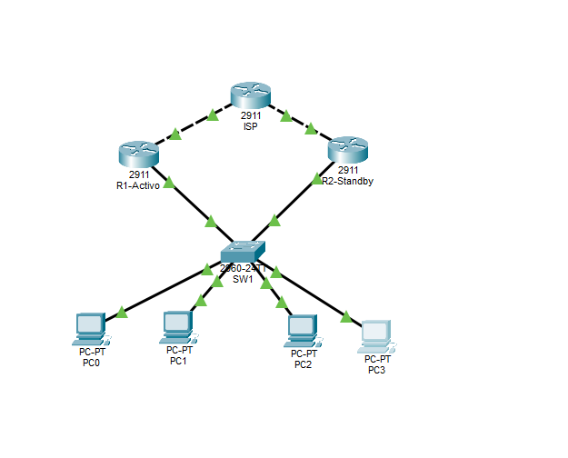
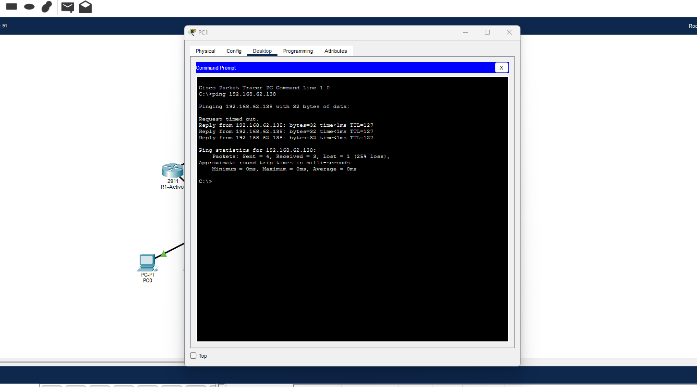
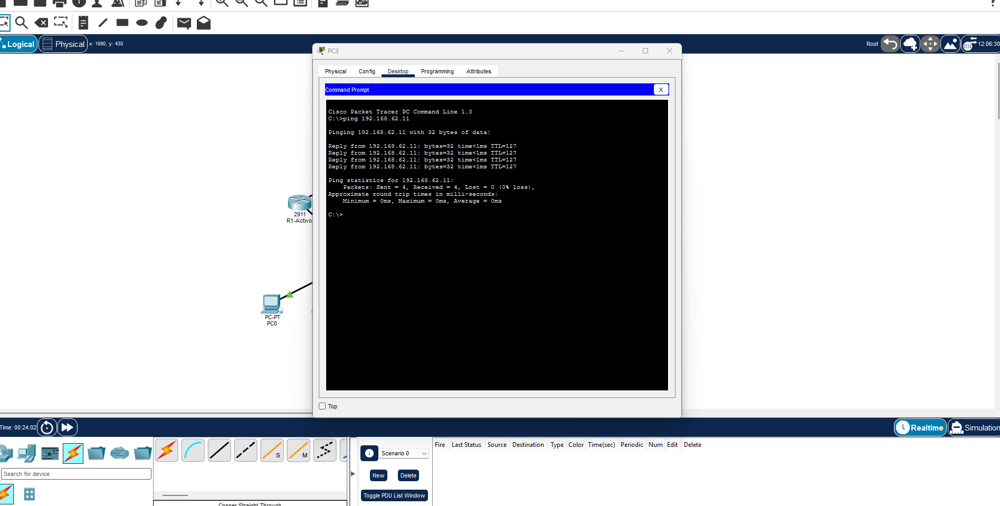

# Tarea 5 - HSRP y OSPF en Cisco Packet Tracer

Universidad de San Carlos de Guatemala
Facultad de Ingeniería - Escuela de Ingeniería en Ciencias y Sistemas
Laboratorio de Redes de Computadoras 1, Sección A - Segundo Semestre 2026

Nombre: Pablo Cutzal
Carné: 202209622

---

## 1. Descripción

Se armó una red en Packet Tracer con dos routers 2911 (R1-Activo y R2-Standby) que dan salida a dos
VLANs a través de un switch 2960 (SW1). Los dos routers comparten un gateway virtual por VLAN usando
**HSRP**, de modo que si R1 se cae, R2 toma el rol de gateway sin que las PCs tengan que cambiar su
configuración. Ambos routers se conectan a un router ISP y todo el enrutamiento se hace con **OSPF**
en el área 0.

- VLAN 12 - Administracion
- VLAN 22 - Operaciones
- Red base: `192.168.62.0/24`, dividida en dos subredes /25 (una por VLAN).

## 2. Topología



```
                 [ ISP ]  (RID 3.3.3.3, Loopback 8.8.8.8)
                G0/0   G0/1
          10.62.1.0/30  10.62.2.0/30
              /               \
     [ R1-Activo ]         [ R2-Standby ]
      RID 1.1.1.1           RID 2.2.2.2
         G0/1                  G0/1
           \  (trunk)  (trunk)  /
            G0/1            G0/2
                  [ SW1 ]
         Fa0/1  Fa0/2  Fa0/3  Fa0/4
           |      |      |      |
          PC0    PC1    PC2    PC3
          VLAN 12       VLAN 22
```

Cables:

- Router a router (R1/R2 hacia ISP): cable serial/cruzado (línea punteada en la topología).
- Router a switch y PC a switch: cable directo (Copper Straight-Through).

### Tabla de puertos de SW1

| Puerto | Conecta a | Modo | Descripción |
|---|---|---|---|
| Fa0/1 - Fa0/2 | PC0, PC1 | access VLAN 12 | PCs-Administracion |
| Fa0/3 - Fa0/4 | PC2, PC3 | access VLAN 22 | PCs-Operaciones |
| G0/1 | R1-Activo G0/1 | trunk | Trunk-hacia-R1 |
| G0/2 | R2-Standby G0/1 | trunk | Trunk-hacia-R2 |

### Direccionamiento

| Dispositivo | Interfaz | Dirección IP | Máscara | Uso |
|---|---|---|---|---|
| R1-Activo | G0/1.12 | 192.168.62.2 | 255.255.255.128 | VLAN 12 |
| R1-Activo | G0/1.22 | 192.168.62.130 | 255.255.255.128 | VLAN 22 |
| R1-Activo | G0/0 | 10.62.1.2 | 255.255.255.252 | Enlace a ISP |
| R2-Standby | G0/1.12 | 192.168.62.3 | 255.255.255.128 | VLAN 12 |
| R2-Standby | G0/1.22 | 192.168.62.131 | 255.255.255.128 | VLAN 22 |
| R2-Standby | G0/0 | 10.62.2.x | 255.255.255.252 | Enlace a ISP |
| ISP | G0/0 | 10.62.1.1 | 255.255.255.252 | Enlace a R1 |
| ISP | Loopback | 8.8.8.8 | 255.255.255.255 | Simula Internet |
| HSRP grupo 12 | IP virtual | 192.168.62.1 | 255.255.255.128 | Gateway VLAN 12 |
| HSRP grupo 22 | IP virtual | 192.168.62.129 | 255.255.255.128 | Gateway VLAN 22 |

| PC | VLAN | Dirección IP | Gateway |
|---|---|---|---|
| PC0 | 12 | 192.168.62.x | 192.168.62.1 |
| PC1 | 12 | 192.168.62.11 | 192.168.62.1 |
| PC2 | 22 | 192.168.62.x | 192.168.62.129 |
| PC3 | 22 | 192.168.62.138 | 192.168.62.129 |

Las PCs usan como gateway la **IP virtual de HSRP**, no la IP real de ningún router.

## 3. Orden en que se configuró

1. SW1: VLANs, puertos de acceso y trunks hacia los routers.
2. R1 y R2: subinterfaces con encapsulación dot1Q para cada VLAN.
3. HSRP en las subinterfaces de R1 y R2.
4. OSPF en R1, R2 e ISP.
5. IP y gateway en las PCs y pruebas de conectividad.

## 4. Scripts de configuración

### 4.1 SW1

```
enable
configure terminal
hostname SW1
vlan 12
 name Administracion
vlan 22
 name Operaciones
exit
interface range fa0/1-2
 description PCs-Administracion
 switchport mode access
 switchport access vlan 12
exit
interface range fa0/3-4
 description PCs-Operaciones
 switchport mode access
 switchport access vlan 22
exit
interface g0/1
 description Trunk-hacia-R1
 switchport mode trunk
exit
interface g0/2
 description Trunk-hacia-R2
 switchport mode trunk
exit
end
write memory
```


### 4.2 R1-Activo

```
enable
configure terminal
hostname R1-Activo
!
interface g0/1
 no shutdown
exit
interface g0/1.12
 encapsulation dot1Q 12
 ip address 192.168.62.2 255.255.255.128
 standby 12 ip 192.168.62.1
 standby 12 priority 110
 standby 12 preempt
exit
interface g0/1.22
 encapsulation dot1Q 22
 ip address 192.168.62.130 255.255.255.128
 standby 22 ip 192.168.62.129
 standby 22 priority 110
 standby 22 preempt
exit
interface g0/0
 ip address 10.62.1.2 255.255.255.252
 no shutdown
exit
!
router ospf 1
 router-id 1.1.1.1
 network 192.168.62.0 0.0.0.127 area 0
 network 192.168.62.128 0.0.0.127 area 0
 network 10.62.1.0 0.0.0.3 area 0
exit
end
write memory
```

R1 tiene prioridad 110 (mayor que el 100 por defecto de R2) y `preempt`, por eso es el router activo
y recupera el rol cuando vuelve a levantar después de una falla.

### 4.3 R2-Standby

```
enable
configure terminal
hostname R2-Standby
!
interface g0/1
 no shutdown
exit
interface g0/1.12
 encapsulation dot1Q 12
 ip address 192.168.62.3 255.255.255.128
 standby 12 ip 192.168.62.1
 standby 12 preempt
exit
interface g0/1.22
 encapsulation dot1Q 22
 ip address 192.168.62.131 255.255.255.128
 standby 22 ip 192.168.62.129
 standby 22 preempt
exit
!
router ospf 1
 router-id 2.2.2.2
 network 192.168.62.0 0.0.0.127 area 0
 network 192.168.62.128 0.0.0.127 area 0
 network 10.62.2.0 0.0.0.3 area 0
exit
end
write memory
```

R2 se queda con la prioridad por defecto (100), así que entra como standby.

### 4.4 ISP

```
enable
configure terminal
hostname ISP
interface loopback 0
 ip address 8.8.8.8 255.255.255.255
exit
router ospf 1
 router-id 3.3.3.3
 network 10.62.1.0 0.0.0.3 area 0
 network 10.62.2.0 0.0.0.3 area 0
 network 8.8.8.8 0.0.0.0 area 0
exit
end
write memory
```

## 5. Verificación

### 5.1 show standby en R1-Activo

```
show standby
```

En R1 el grupo 12 aparece como `State is Active`, con IP virtual `192.168.62.1`, MAC virtual
`0000.0C07.AC0C`, prioridad 110 y preempt habilitado. El grupo 22 usa la IP virtual
`192.168.62.129` y la MAC virtual `0000.0C07.AC16`.


### 5.2 show standby en R2-Standby

En R2 el grupo 12 aparece como `State is Standby`, con prioridad 100 y `Active router is 192.168.62.2`
(la IP real de R1). Esto confirma que R2 está listo para tomar el gateway si R1 falla.


### 5.3 show ip ospf neighbor

```
show ip ospf neighbor
```

R1 forma adyacencia con:

| Neighbor ID | Dirección | Interfaz |
|---|---|---|
| 3.3.3.3 (ISP) | 10.62.1.1 | GigabitEthernet0/0 |
| 2.2.2.2 (R2) | 192.168.62.3 | GigabitEthernet0/1.12 |
| 2.2.2.2 (R2) | 192.168.62.131 | GigabitEthernet0/1.22 |

Los mensajes `%OSPF-5-ADJCHG ... from LOADING to FULL, Loading Done` indican que las adyacencias
terminaron de formarse.


### 5.4 show ip route

```
show ip route
```

En la tabla de R1 aparecen como rutas OSPF (`O`):

- `8.8.8.8/32 [110/2] via 10.62.1.1` - la loopback del ISP.
- `10.62.2.0/30` - el enlace ISP-R2, aprendido por tres caminos de igual costo (vía R2 en cada VLAN y vía ISP).

Y como conectadas (`C`/`L`) las subredes `192.168.62.0/25`, `192.168.62.128/25` y `10.62.1.0/30`.


## 6. Pruebas de conectividad

| Origen | Destino | VLAN origen | VLAN destino | Resultado |
|---|---|---|---|---|
| PC1 (192.168.62.11) | PC3 (192.168.62.138) | 12 | 22 | Exitoso (3/4, el primero se pierde por ARP) |
| PC3 (192.168.62.138) | PC1 (192.168.62.11) | 22 | 12 | Exitoso (4/4) |

El TTL de 127 en las respuestas confirma que el paquete pasó por un router (el gateway HSRP).

### Ping desde PC1 hacia VLAN 22



### Ping desde PC3 hacia VLAN 12



## 7. Conclusiones

- HSRP permite que las PCs tengan un único gateway (la IP virtual) mientras dos routers físicos
  comparten la responsabilidad, eliminando el punto único de falla.
- La prioridad y el `preempt` determinan qué router es el activo y aseguran que vuelva a serlo al
  recuperarse.
- OSPF distribuye automáticamente las rutas entre R1, R2 y el ISP, por lo que no hace falta
  configurar rutas estáticas.

## 8. Archivos entregados

```
Tarea_5/
├── Manualtecnico.md
└── img/
    ├── Tarea5_202209622.pkt
    ├── topologia.png
    ├── show interfaces trunk.png
    ├── show standby.png
    ├── show standbyr2.png
    ├── show ip ospf neighbor.png
    ├── show ip route.png
    ├── pingpc1.png
    └── pingpc4.png
```
